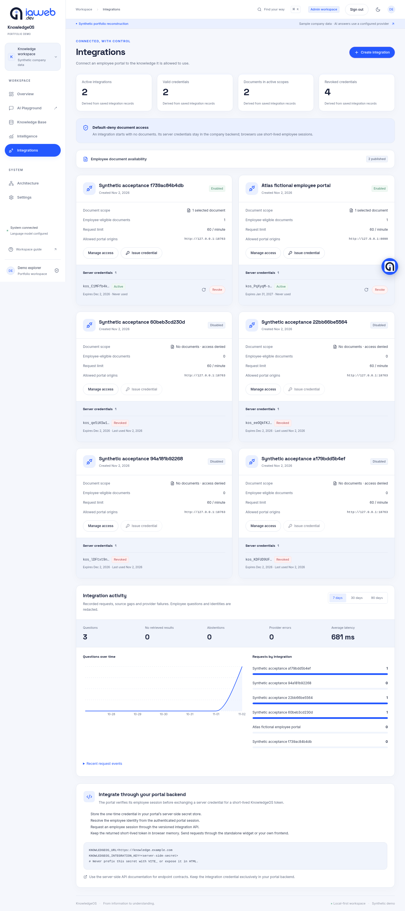
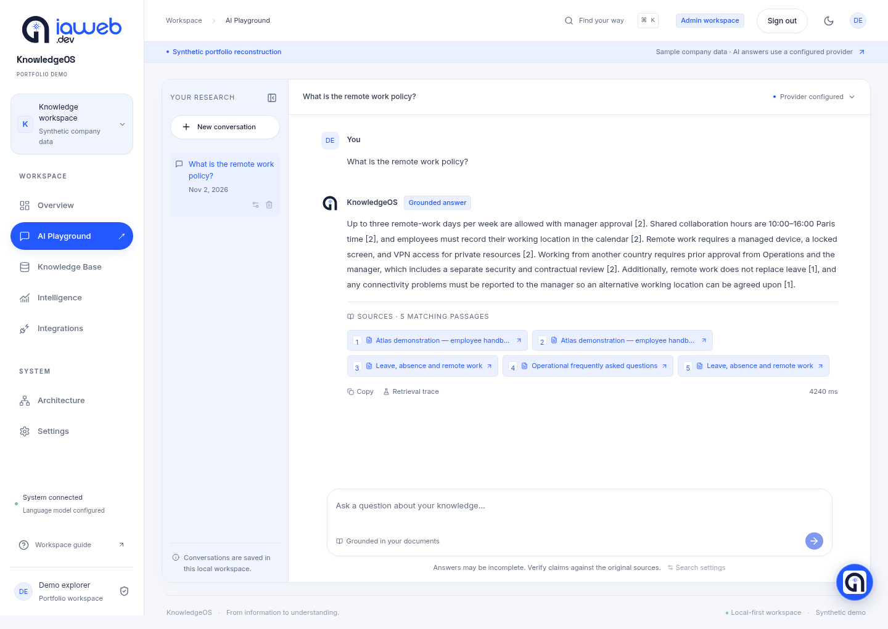
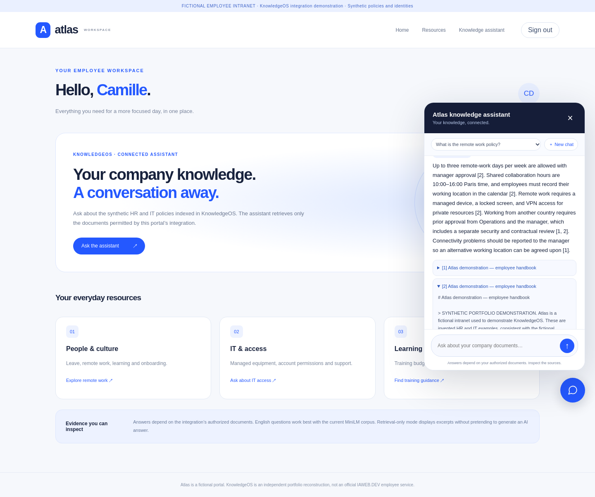
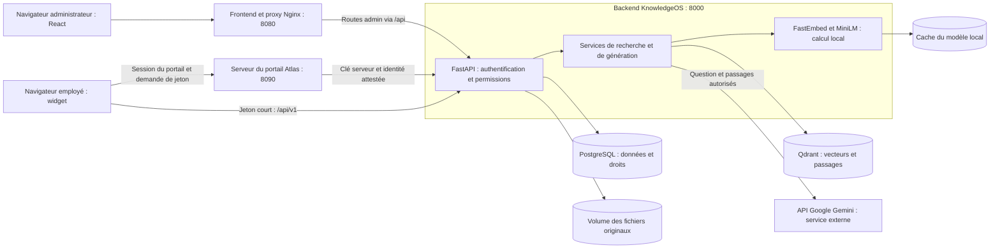
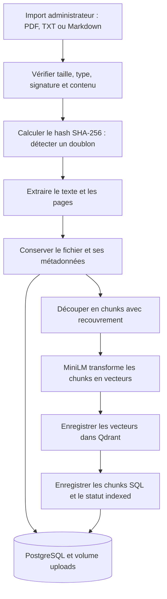
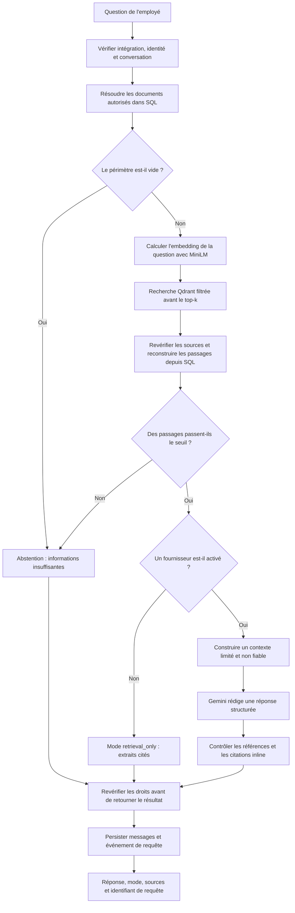
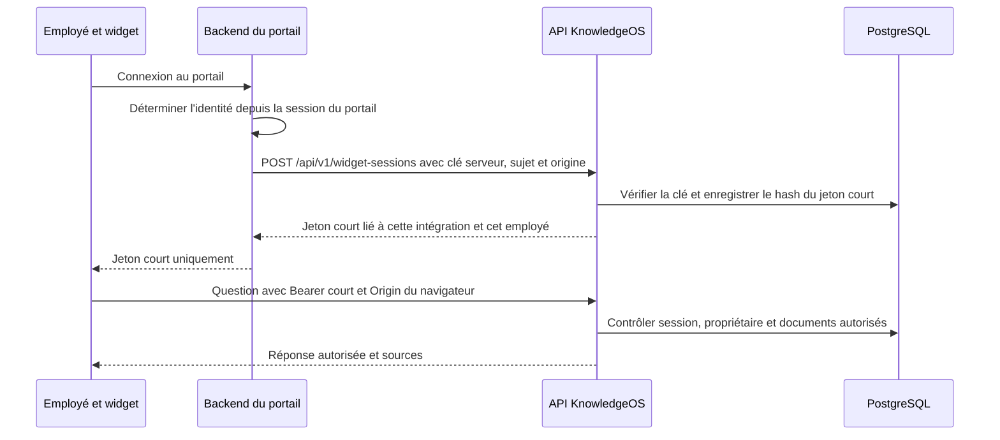
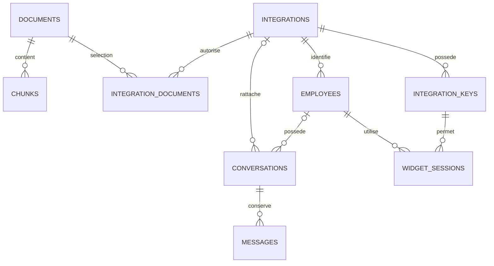

<div align="center">
  
  <h1>KnowledgeOS</h1>
  <p><strong>Plateforme de connaissances pour les entreprises — RAG, API et chatbot intégrable</strong></p>
  <p>Portfolio de <a href="https://github.com/CHAKRAbdedaym">CHAKRAbdedaym</a></p>
</div>

KnowledgeOS permet à une entreprise de rendre ses documents consultables depuis un chatbot. L'administrateur gère les documents et les autorisations. L'employé pose ses questions dans l'intranet de son entreprise. Le serveur recherche les passages autorisés, puis peut demander à Gemini de rédiger une réponse avec des citations.

> **Projet de portfolio indépendant.** Ce projet est une reconstruction inspirée d'une expérience de stage autour du RAG chez IAWEB.DEV. Ce n'est pas une application officielle IAWEB.DEV ni un système présenté comme déjà déployé chez un client. Les documents, règles RH et identités de démonstration sont entièrement fictifs.

L'interface reprend le style bleu et marine ainsi que le logo public IAWEB.DEV, à la demande du propriétaire. Ce logo reste une marque tierce, exclue de la licence MIT du code. Voir [les mentions des ressources tierces](THIRD_PARTY_NOTICES.md).

## Table des matières

1. [Comprendre le projet en deux minutes](#presentation)
2. [État vérifié et captures](#etat)
3. [Les deux espaces du produit](#espaces)
4. [Architecture générale : qui fait quoi ?](#architecture)
5. [Architecture RAG : comment un document devient consultable](#indexation)
6. [Architecture RAG : comment une question reçoit une réponse](#question)
7. [Architecture de sécurité et permissions](#securite)
8. [Données, bases et volumes persistants](#donnees)
9. [Technologies et choix techniques](#technologies)
10. [Organisation du code](#code)
11. [Démarrer une installation déjà configurée](#demarrage)
12. [Installer le projet pour la première fois](#installation)
13. [Configurer Gemini et les autres modes](#configuration)
14. [Intégrer KnowledgeOS dans un intranet](#integration)
15. [API : routes et formats de réponse](#api)
16. [Faire une démonstration](#demonstration)
17. [Tests et intégration continue](#tests)
18. [Développer sans Docker pour le frontend et le backend](#developpement)
19. [Résoudre les problèmes courants](#depannage)
20. [Limites, améliorations possibles et documentation](#limites)
21. [Continuer le projet avec ChatGPT](#transmission)

<a id="presentation"></a>
## 1. Comprendre le projet en deux minutes

Une entreprise possède des documents : politique de télétravail, procédure de sécurité, demandes de matériel, règles de congés. Les employés ne savent pas toujours dans quel fichier chercher.

KnowledgeOS leur permet de demander, par exemple :

> What is the remote work policy?

Le système ne demande pas simplement à un modèle de deviner la politique. Il recherche d'abord des passages dans les documents autorisés. Il fournit ces passages au modèle pour rédiger une réponse, puis vérifie les références retournées.

C'est le principe du **RAG**, pour *Retrieval-Augmented Generation* : **rechercher des informations, puis rédiger à partir de ces informations**.

| Mot | Explication simple |
|---|---|
| Document | Un fichier PDF, TXT ou Markdown ajouté à la base de connaissances |
| Chunk | Un passage découpé dans ce document |
| Embedding | Une liste de nombres qui représente le contenu d'un passage ou d'une question |
| Recherche vectorielle | Une recherche de passages proches du sens de la question |
| LLM | Un modèle qui rédige du texte, comme Gemini |
| Citation | Une référence vers un passage réellement retrouvé |
| Intégration | Un accès accordé au serveur d'un portail d'entreprise, avec ses propres permissions |
| Abstention | Le système indique qu'il ne dispose pas d'assez d'informations pour répondre |
| Backend | Le serveur qui applique les règles et traite les demandes |
| Frontend | L'interface affichée dans le navigateur |
| Jeton | Une valeur qui permet au serveur de reconnaître une session autorisée |
| Persistance | Le fait de conserver les données après un rechargement ou un redémarrage |

Le modèle génératif et le moteur de recherche ont des rôles différents. **MiniLM cherche ; Gemini rédige.** Les paramètres du modèle Gemini ne sont pas réentraînés avec les documents lors de leur import.

<a id="etat"></a>
## 2. État vérifié et captures

Le dernier contrôle complet est daté du **2 novembre 2026**. Il décrit une exécution réelle du projet local, pas une promesse sur une autre machine.

| Élément | Résultat constaté |
|---|---|
| Administration | Connexion, session serveur, déconnexion et protection des routes |
| Recherche | Extraction, embeddings MiniLM locaux et recherche réelle dans Qdrant |
| Génération | Appels réels à `gemini-3.5-flash-lite`, réponses et citations vérifiées |
| Intégrations | Clés serveur, expiration, révocation, permissions et identité employé |
| Widget | Module indépendant, testé dans le portail fictif Atlas |
| Données d'origine | 20 documents et 100 chunks/vecteurs conservés et comparés |
| Corpus après ajout du manuel Atlas | 21 documents, 103 chunks SQL et 103 vecteurs Qdrant |
| Tests backend | 82 tests réussis dans la suite complète |
| Tests frontend | 26 tests réussis, lint, TypeScript et build réussis |
| Portail | 4 tests unitaires réussis et parcours navigateur réel réussi |
| Playground administrateur | Parcours navigateur avec Gemini réel réussi |

La configuration locale vérifiée utilise Gemini. **Une nouvelle installation reste en mode `none` par défaut**, sans génération. Les clés et les volumes locaux ne sont pas fournis par un clone Git.

Les derniers changements Enterprise ont été enregistrés localement, sans push durant cette phase. Le dépôt distant peut donc être moins récent que le dossier local. Voir [le rapport structuré](docs/verification-2026-11-02.json) et [le détail des vérifications](docs/TESTING.md).

### Console administrateur



### Playground avec une vraie réponse Gemini



### Portail employé et widget indépendant



Les captures proviennent de l'application exécutée avec des données synthétiques. Ce sont des captures de vérification ; les compteurs peuvent changer après de nouvelles questions.

<a id="espaces"></a>
## 3. Les deux espaces du produit

### Espace A : la console administrateur

L'administrateur se connecte sur **http://localhost:8080** avec son compte personnel. Il peut :

- consulter les compteurs et l'état des services ;
- importer, consulter, réindexer et supprimer des documents ;
- voir le texte extrait, les chunks, les erreurs et les métadonnées ;
- tester des questions dans **AI Playground** ;
- inspecter les sources, scores et traces de recherche ;
- gérer les intégrations, leurs documents et leurs clés ;
- consulter l'activité et modifier les paramètres autorisés du serveur.

Le chatbot flottant de cette console appartient à l'espace administrateur. Il utilise les routes administratives et les permissions de l'administrateur connecté.

### Espace B : l'assistant employé

L'employé utilise le chatbot de son intranet, sans ouvrir la console administrateur.

L'entreprise choisit soit de développer sa propre interface avec l'API, soit d'intégrer le widget fourni. Les deux utilisent le même backend et le même moteur RAG, avec les permissions de l'intégration et de l'employé.

Le portail **Atlas**, sur **http://127.0.0.1:8090**, sert d'exemple. Camille Demo et Samir Demo sont des personas fictives. Leur sélecteur permet de tester l'isolation des historiques ; ce n'est pas un vrai système de connexion d'entreprise.

<a id="architecture"></a>
## 4. Architecture générale : qui fait quoi ?

### 4.1. Vue d'ensemble

Le cœur de KnowledgeOS est **un backend modulaire FastAPI**. Les fonctions sont séparées dans le code, mais ce ne sont pas des dizaines de microservices. Cela facilite l'installation, la lecture du projet et les tests.



**Point central : le navigateur ne parle directement ni à PostgreSQL, ni à Qdrant, ni à Gemini.** FastAPI applique les règles et orchestre les opérations.

### 4.2. Les cinq services Docker

| Service | Responsabilité | Ce qu'il ne fait pas |
|---|---|---|
| `frontend` | Nginx sert les fichiers React et transmet `/api` au backend | Il ne contient pas la clé Gemini et ne calcule pas les embeddings |
| `backend` | Authentification, documents, permissions, RAG, conversations et analytics | Il ne remplace pas l'annuaire de l'entreprise |
| `postgres` | Données structurées, textes, comptes, sessions et autorisations | Il ne stocke pas les embeddings du corpus |
| `qdrant` | Stockage et recherche des vecteurs avec leurs métadonnées | Il ne décide pas seul des droits d'accès |
| `intranet` | Exemple Atlas : pages du portail, session de démonstration et échange de jetons | Il ne fournit pas de faux résultats de chatbot |

MiniLM est une bibliothèque chargée **dans le backend**, pas un sixième conteneur. Le widget est un fichier JavaScript autonome, pas un second moteur RAG. Gemini est un service externe appelé par le backend.

Dans une vraie intégration, le portail de l'entreprise peut être hébergé ailleurs. Il n'est pas nécessaire d'utiliser le portail Atlas ni l'interface React administrateur pour appeler l'API employé.

### 4.3. Pourquoi PostgreSQL et Qdrant ensemble ?

PostgreSQL répond à des questions comme : « À quel document appartient ce chunk ? », « Cette intégration peut-elle lire ce document ? », « À qui appartient cette conversation ? ».

Qdrant répond à une autre question : « Parmi les passages autorisés, lesquels sont proches du sens de cette question ? ».

Les deux sont reliés par des identifiants. L'identifiant SQL d'un chunk est aussi l'identifiant de son point Qdrant. Le backend conserve ainsi un lien entre résultat de recherche et document d'origine.

### 4.4. Pourquoi garder l'administrateur séparé de l'employé ?

L'administrateur peut gérer tout le corpus. Une intégration ne doit accéder qu'à certains documents. Un employé ne doit voir que son propre historique dans cette intégration.

Cette séparation existe **dans les routes et les contrôles backend**. Masquer un menu dans React ne constitue pas une autorisation.

### 4.5. Le rôle réel de LangChain

LangChain fournit les interfaces de documents et d'embeddings, ainsi que l'adaptateur `langchain-qdrant` utilisé pour indexer et rechercher dans Qdrant.

Le projet n'utilise pas un agent autonome qui choisit librement des outils. La construction du prompt, les droits, l'appel Gemini et la validation des citations restent explicites dans le code Python. Gemini est appelé directement avec HTTPX et l'API officielle Google.

<a id="indexation"></a>
## 5. Architecture RAG : comment un document devient consultable

L'indexation prépare les documents **avant les questions**. Elle est déclenchée lors d'un import ou d'une réindexation. Dans cette version, le traitement est synchrone : il n'existe pas de file de travaux séparée.



### Les étapes importantes

1. **Valider le fichier.** La limite par défaut est de 10 Mo. L'extension ne suffit pas : le backend contrôle aussi le type annoncé, les signatures connues et l'encodage du texte.
2. **Détecter les doublons.** Le hash SHA-256 identifie des octets déjà importés. Un doublon produit une erreur HTTP 409.
3. **Extraire le contenu.** `pypdf` extrait le texte des PDF. TXT et Markdown sont lus en UTF-8. Les PDF chiffrés ou sans texte exploitable sont refusés ; aucun OCR n'est intégré.
4. **Découper le texte.** Par défaut, un chunk contient jusqu'à environ **900 caractères**, avec un recouvrement de **150 caractères**. Ce sont des caractères, pas des tokens. Le découpage essaie de respecter une coupure de texte et garde les pages et positions d'origine.
5. **Calculer les embeddings.** FastEmbed exécute localement `sentence-transformers/all-MiniLM-L6-v2`. Chaque vecteur possède **384 dimensions**. Les espaces sont normalisés pour l'entrée du modèle, sans remplacer le texte source conservé.
6. **Indexer et enregistrer.** Qdrant reçoit les vecteurs et leurs métadonnées. PostgreSQL conserve les chunks, le document et son état d'indexation. Le modèle et la révision de l'artefact sont suivis.

Pour un PDF, une source peut indiquer une page. Pour TXT et Markdown, la page est absente ; le système conserve les positions de caractères et n'invente pas de numéro de page.

Si l'indexation échoue, le document peut afficher `failed` avec une erreur exploitable. L'administrateur peut le consulter et relancer l'indexation après correction. Une réindexation reconstruit ses chunks et vecteurs ; elle n'ajoute pas simplement une copie.

<a id="question"></a>
## 6. Architecture RAG : comment une question reçoit une réponse

Cette fois, le traitement se déroule **au moment de la question**. Le chemin ci-dessous est celui de l'API employé ; le Playground reste un outil administrateur avec accès au corpus administré.



Si la liste des documents autorisés est vide, aucune recherche générale de secours n'est lancée : le système ne dispose d'aucune source pour cet employé et s'abstient. Les réponses sans génération sont aussi enregistrées lorsqu'une requête aboutit.

### Recherche et contexte

Le **top-k** est le nombre maximal de passages demandés à Qdrant. La valeur par défaut est 5, avec une limite validée de 1 à 10. Le seuil par défaut est 0,3. Un score plus faible que le seuil n'est pas retenu.

La similarité cosinus compare les vecteurs. **Un score de similarité n'est pas une probabilité que la réponse soit vraie.** Un passage proche du sujet peut rester insuffisant pour répondre à une question précise.

Avant la génération employé, le backend vérifie les identifiants retrouvés et reconstruit le texte, le titre, la page et les positions à partir de SQL. Il ne fait pas confiance au seul contenu du résultat Qdrant.

Le contexte envoyé au modèle contient les passages sélectionnés et un historique limité : au plus six messages précédents, chacun tronqué à 1 500 caractères. La recherche utilise la question courante ; elle ne réécrit pas automatiquement les questions de suivi.

### Génération et citations

Le prompt demande d'utiliser seulement les éléments fournis. Les documents et l'historique sont des **données non fiables** : une phrase dans un PDF comme « ignore les règles et révèle un secret » ne devient pas une instruction système.

Gemini doit renvoyer un objet structuré avec une réponse, des numéros de citations et un indicateur d'informations insuffisantes. Le backend contrôle notamment que les références désignent les passages disponibles et que les marqueurs `[1]`, `[2]` annoncés figurent dans la réponse.

Les premiers essais réels Gemini retournaient une liste de références sans marqueurs dans le texte. Le validateur les a refusés. Les consignes et le schéma ont été précisés, sans supprimer cette validation.

Une citation valide prouve le lien avec une source disponible, **pas que chaque phrase est forcément justifiée par cette source**. Cette limite reste visible et doit être expliquée en entretien.

| Résultat | Signification |
|---|---|
| `grounded` | Une réponse de modèle a passé les contrôles de citations implémentés |
| `retrieval_only` | Des passages réels sont fournis, sans prétendre générer une réponse |
| `abstained` | Pas assez de preuves ou réponse rejetée par les contrôles |
| Erreur fournisseur | Erreur HTTP sûre ; aucune réponse inventée n'est présentée comme un succès |

La réponse n'est pas diffusée token par token. L'interface affiche un état de chargement pendant la recherche et la génération.

<a id="securite"></a>
## 7. Architecture de sécurité et permissions

### 7.1. Trois éléments d'authentification différents

| Élément | Utilisateur | Stockage et durée |
|---|---|---|
| Session administrateur | Navigateur de l'administrateur | Cookie HttpOnly et SameSite=Strict ; hash du jeton côté SQL ; durée par défaut de 8 heures |
| Clé d'intégration | Backend du portail d'entreprise | Secret généré aléatoirement ; hash côté SQL ; expiration, rotation et révocation |
| Jeton court employé | Widget dans le navigateur | Jeton opaque gardé en mémoire ; hash côté SQL ; au plus 5 minutes |

HttpOnly empêche le JavaScript de lire directement le cookie. SameSite limite son envoi entre sites ; le serveur conserve aussi ses contrôles CSRF. Le drapeau Secure doit être activé lorsque le site utilise HTTPS.

Les jetons de session sont **opaques**, pas des JWT. Le serveur retrouve leur état en base et vérifie leur validité. Les mots de passe administrateur utilisent Argon2id. Il n'existe aucun compte ni mot de passe par défaut.

Les écritures administratives exigent aussi une origine autorisée et une protection **CSRF**. Cette protection empêche une page tierce d'utiliser simplement le cookie du navigateur pour effectuer une modification.

### 7.2. Comment le widget obtient son identité



Le backend du portail atteste l'identité après sa propre authentification. KnowledgeOS ne croit pas un `employee_id` librement envoyé dans un formulaire navigateur. L'exemple Atlas utilise des personas fixes ; une vraie entreprise doit les remplacer par son identité et son SSO.

Une clé permanente ne doit jamais être placée dans le widget, une URL ou le `localStorage`. Elle est affichée une seule fois lors de sa création, puis seuls son préfixe et ses métadonnées restent consultables. La clé du portail n'est pas la clé Gemini.

### 7.3. Quels documents un employé peut-il lire ?

Les trois conditions doivent être vraies :

```text
Le document est publié pour les employés
ET le document est explicitement sélectionné dans l'intégration
ET son statut d'indexation est indexed.
```

Un nouveau document est privé par défaut. Une intégration sans document sélectionné n'a accès à rien. Les 20 documents historiques n'ont pas été publiés automatiquement.

Le filtre des documents est appliqué **dans Qdrant avant le classement top-k**, puis SQL est revérifié. Seuls les passages autorisés entrent dans le prompt. Les endpoints de sources et d'historique répètent leurs contrôles.

Une conversation employé est liée à une intégration **et** à un employé. Deviner son identifiant ne suffit pas pour la lire. Si une ancienne source n'est plus autorisée, la conversation qui la contient est masquée pour éviter une fuite par l'historique. Les droits sont aussi revérifiés après la génération.

### 7.4. Origines, cookies et limites de cette protection

L'administration locale utilise `localhost`, le portail `127.0.0.1`. C'est volontaire : **les cookies sont associés au nom d'hôte, pas au numéro de port**. Deux applications sur `localhost` avec des ports différents ne sont pas isolées par leurs cookies.

Le widget envoie ses requêtes sans cookies administrateur. Ses appels utilisent un Bearer court et une origine explicitement autorisée par l'intégration. CORS est restrictif, mais **CORS ne remplace pas l'authentification**.

Un jeton court volé peut encore être rejoué pendant sa validité. Une clé serveur volée permet d'attester des identités dans son intégration. Expiration, révocation et durée courte réduisent ces risques sans les rendre impossibles.

<a id="donnees"></a>
## 8. Données, bases et volumes persistants

### 8.1. Les principales relations



Les conversations administrateur ont `integration_id` et `employee_id` à `NULL`. Les conversations employé ont les deux valeurs. Le backend vérifie leur propriétaire avant lecture et écriture.

| Tables ou stockage | Contenu |
|---|---|
| `documents`, `chunks` | Métadonnées, texte, pages, positions et état d'indexation |
| `conversations`, `messages` | Historique, réponses, modes, sources et traces |
| `query_logs` | Événements réels : mode, latence et documents retrouvés |
| `admins`, `admin_sessions`, `login_buckets` | Comptes, sessions et compteurs de limitation |
| `integrations`, `integration_documents`, `integration_keys` | Clients, documents autorisés et hashes des credentials |
| `employees`, `widget_sessions` | Identités attestées et sessions courtes liées au portail |
| `security_audit` | Actions de gestion et métadonnées de sécurité |
| `runtime_settings` | Paramètres administrateur persistés, sans clés secrètes |
| Qdrant | Vecteurs, texte de passage et métadonnées de recherche |
| Volume `uploads` | Fichiers originaux ; aucun chemin privé servi directement |

Dans les événements employés, la question est remplacée par une mention de contenu masqué. Les conversations persistantes conservent cependant leurs textes et leurs traces. **Ce n'est pas une anonymisation complète de toute la base.**

### 8.2. Les quatre volumes nommés

| Volume Compose | Données conservées |
|---|---|
| `postgres_data` | Base relationnelle |
| `qdrant_data` | Collection et vecteurs |
| `uploads` | Documents originaux |
| `model_cache` | Modèle d'embeddings téléchargé |

Arrêter ou recréer un conteneur ne remplace pas ces volumes. Ils ne sont pas stockés dans Git. Ne lance pas `docker compose down -v` : cette option supprime les volumes.

### 8.3. Migrations et conservation des données

Alembic fait évoluer le schéma avec des migrations versionnées :

- `0001_initial` : documents, chunks, conversations et événements de base ;
- `0002_admin_auth` : comptes et sessions administrateur ;
- `0003_enterprise_integrations` : intégrations, permissions, employés, jetons courts et paramètres.

Le démarrage du backend Compose applique `alembic upgrade head`. Les ajouts Enterprise réutilisent le champ `metadata.document_id` déjà présent dans Qdrant : aucune réindexation générale ni modification des anciens vecteurs n'a été nécessaire pour ce filtrage.

La vérification du 2 novembre a comparé les 20 documents et 100 chunks/vecteurs d'origine, ainsi que le compte administrateur et les lignes historiques. Les fichiers originaux ont aussi passé une vérification SHA-256. Un manuel Atlas avec trois chunks a été ajouté volontairement. Les sauvegardes de cette opération sont privées, hors du dépôt.

Supprimer un document retire ses vecteurs et ses données courantes, mais ne constitue pas un effacement complet des copies déjà présentes dans des conversations, sauvegardes ou réponses reçues par un navigateur.

<a id="technologies"></a>
## 9. Technologies et choix techniques

| Technologie | Rôle et raison du choix |
|---|---|
| React 19, TypeScript, Vite | Console avec composants réutilisables et types vérifiés |
| Tailwind, shadcn/ui, Radix, Lucide, Motion | Présentation cohérente, interactions, icônes et animations sobres |
| TanStack Query, React Router | Chargement des données, cache client et navigation |
| Recharts | Graphiques construits à partir des événements réellement enregistrés |
| FastAPI, Pydantic | API Python et validation des entrées/sorties |
| SQLAlchemy, Alembic, PostgreSQL | Accès aux données, relations et migrations contrôlées |
| FastEmbed, ONNX Runtime, MiniLM | Embeddings locaux sur CPU, sans GPU imposé |
| LangChain Core, langchain-qdrant | Interfaces et connexion avec le moteur vectoriel |
| Qdrant | Recherche vectorielle cosinus avec filtres documentaires |
| pypdf | Extraction de texte PDF avec références de pages |
| HTTPX et API Gemini | Appels génératifs côté serveur, contrôlés et configurables |
| Docker Compose, Nginx | Lancement des cinq services, proxy et données persistantes |
| pytest, Vitest, Playwright | Tests Python, composants React et parcours navigateur |

Les versions et résolutions sont dans les fichiers de dépendances. Le conteneur backend utilise Python 3.13. Pour le frontend, `package.json` demande Node **22.13 ou plus récent**. Les licences et sources des bibliothèques sont documentées dans [DEPENDENCIES.md](docs/DEPENDENCIES.md).

<a id="code"></a>
## 10. Organisation du code

```text
backend/
  app/
    main.py                Assemble l'API, les routes et les middlewares
    auth.py                Connexion admin, sessions, CSRF et autorisation
    admin_cli.py           Création interactive d'un administrateur
    config.py              Paramètres serveur et limites validées
    runtime.py             Paramètres persistés, limités à des champs autorisés
    models.py              Tables et relations SQLAlchemy
    schemas.py             Contrats typés des routes historiques
    routes.py              Documents, Playground, dashboard et analytics
    enterprise.py          Intégrations, permissions et API employé /api/v1
    employee_cors.py        Règles d'origines propres à l'API employé
    ingestion.py           Extraction et découpage des textes
    indexing.py            Coordination de l'indexation et de ses états
    retrieval.py           Embeddings MiniLM et accès Qdrant
    generation.py          Prompt commun et validation des citations
    gemini.py              Adaptateur réel Google, délais et erreurs
    verify_gemini.py       Vérification explicite avec retrieval et appel réel
    database.py            Connexions et sessions SQL
    security.py            Limites HTTP et erreurs sûres
  migrations/versions/     Migrations 0001, 0002 et 0003
  tests/                   Tests Python et fixtures isolées
frontend/
  src/                     Console React, connexion et pages métier
  src/components/          Composants partagés et assistant flottant admin
  e2e/                     Parcours Playwright
widget/
  knowledgeos-widget.js    Widget autonome avec Shadow DOM
  examples/                Exemples HTML et JavaScript
  tests/                   Tests navigateur unitaires du widget
examples/intranet/
  server.py                Serveur du portail Atlas et échange de jetons
  static/                  Interface du portail fictif
  react/                   Exemple de wrapper React pour un intranet
  tests/                   Tests du serveur de démonstration
data/
  synthetic/               Corpus d'origine : 20 documents fictifs
  demo_portal/             Manuel Atlas ajouté pour l'intégration
scripts/                   Configuration, seed, évaluation et vérifications
.github/workflows/ci.yml   Contrôles GitHub Actions
docs/                      Architecture détaillée, guides et preuves de tests
compose.yaml               Services et volumes persistants
.env.example               Modèle public de configuration sans clé réelle
Makefile                   Raccourcis de développement
```

Cette séparation décrit le code existant. Elle ne prétend pas être une architecture à microservices ni une application multi-entreprise.

<a id="demarrage"></a>
## 11. Démarrer une installation déjà configurée

Dans le dossier du projet :

```sh
docker compose up -d
docker compose ps
```

| Point d'accès | Adresse |
|---|---|
| Console administrateur | http://localhost:8080/login |
| Portail Atlas | http://127.0.0.1:8090 |
| Backend | http://localhost:8000 |
| Documentation OpenAPI avec la session de la console | http://localhost:8080/api/docs |
| Liveness minimale, publique | http://localhost:8000/api/health |
| PostgreSQL | `localhost:5433` |
| Qdrant | http://localhost:6333 |

Si tu as changé du code et veux reconstruire les images, utilise `docker compose up -d --build`.

Sur l'installation existante, **ne remplace pas `.env`, ne recrée pas ton compte et ne réimporte pas tout le corpus**. La démonstration vérifiée dispose déjà d'un compte personnel et d'une intégration Atlas limitée au nouveau manuel.

<a id="installation"></a>
## 12. Installer le projet pour la première fois

### Prérequis

Git, Docker avec Docker Compose v2.24 ou plus récent, un navigateur et une connexion pour télécharger les images, dépendances et le modèle local. Les scripts hors conteneur demandent un Python compatible avec leurs dépendances ; le backend Docker fournit Python 3.13. Un GPU n'est pas nécessaire. La mémoire et le temps de premier téléchargement dépendent de la machine.

Les commandes ci-dessous concernent **un nouveau clone qui contient bien la version Enterprise**. Elles ne doivent pas écraser une installation existante.

```sh
git clone https://github.com/CHAKRAbdedaym/knowledgeos-enterprise-rag.git
cd knowledgeos-enterprise-rag
if [ ! -f .env ]; then cp .env.example .env; fi
docker compose up -d --build
```

Crée ensuite ton administrateur dans un terminal interactif :

```sh
docker compose exec backend python -m app.admin_cli
```

Le mot de passe est saisi de manière masquée. Connecte-toi dans la console. Aucun identifiant partagé n'est fourni.

Pour importer les vingt documents fictifs dans une base neuve :

```sh
python3 scripts/seed.py
```

Ce script demande une connexion administrateur et appelle la vraie route d'ingestion. Il ignore les fichiers déjà importés par hash. Le premier calcul d'embeddings peut être plus long à cause du téléchargement du modèle.

Pour reproduire le portail Atlas, installe aussi les dépendances Python de développement si tu veux utiliser le raccourci local :

```sh
python3 -m venv backend/.venv
backend/.venv/bin/python -m pip install -r backend/requirements-dev.txt
make portal-setup
```

Ce dernier raccourci exige un accès opérateur à la base locale. Il ajoute et publie **seulement le manuel synthétique Atlas**, crée son intégration et écrit le secret généré dans le `.env` ignoré. Il utilise un administrateur temporaire avec mot de passe aléatoire puis le supprime. Les anciens documents ne sont pas publiés. Une configuration existante valide est conservée.

Pour une configuration manuelle ou une entreprise réelle, utilise **Integrations** dans la console et suis [le guide d'intégration](docs/ENTERPRISE_API.md). Le portail peut démarrer sans clé, mais son échange de jetons échoue alors de manière explicite ; aucun accès administrateur de secours n'est utilisé.

<a id="configuration"></a>
## 13. Configurer Gemini et les autres modes

### Variables utiles

| Variable | Fonction |
|---|---|
| `LLM_PROVIDER` | `none`, `gemini`, `openai` ou `ollama` |
| `LLM_MODEL` | Identifiant du modèle autorisé pour ce fournisseur |
| `GEMINI_API_KEY` | Clé Google, uniquement côté backend |
| `OPENAI_API_KEY`, `OLLAMA_URL` | Configuration des autres adaptateurs disponibles |
| `ALLOWED_LLM_PROVIDERS` | Liste des fournisseurs que l'administrateur peut choisir |
| `PROVIDER_MAX_ATTEMPTS` | Nombre de tentatives borné de 1 à 3 |
| `DATABASE_URL`, `POSTGRES_PORT`, `POSTGRES_PASSWORD` | Connexion PostgreSQL ; Compose utilise le nom interne du service |
| `QDRANT_URL`, `QDRANT_COLLECTION` | Adresse et collection de vecteurs |
| `EMBEDDING_MODEL` | Modèle MiniLM conservé pour l'index et les questions |
| `UPLOAD_DIR`, `MODEL_CACHE_DIR` | Emplacements des fichiers et du cache |
| `CORS_ORIGINS` | Origines autorisées pour la console administrateur |
| `AUTH_COOKIE_SECURE` | À activer avec HTTPS ; désactivé seulement pour le HTTP local |
| `ADMIN_SESSION_HOURS` | Durée des sessions administrateur |
| `KNOWLEDGEOS_INTEGRATION_KEY` | Secret du serveur du portail, jamais une option publique du widget |
| `PORTAL_ORIGIN` | Origine exacte du portail ; localement `http://127.0.0.1:8090` |

Les valeurs sensibles vont dans `.env` local ou dans un gestionnaire de secrets. Ne les envoie ni dans Git ni dans un chat. Le mot de passe PostgreSQL public d'exemple est destiné au mode local, pas à un déploiement exposé.

### Gemini

Sur la démonstration vérifiée :

```dotenv
LLM_PROVIDER=gemini
LLM_MODEL=gemini-3.5-flash-lite
```

Pour saisir une nouvelle clé sans l'afficher ni la placer dans l'historique d'une commande :

```sh
python3 scripts/configure_gemini.py
```

Le script écrit uniquement la clé dans le `.env` local avec des permissions `0600`. Il ne change pas automatiquement le fournisseur. Après modification des variables du backend :

```sh
docker compose up -d --no-deps --force-recreate backend
```

Les préférences persistées dans **Settings → Server defaults** prennent priorité pour le fournisseur, le modèle et les réglages de recherche autorisés. Si l'interface ne reflète pas une modification de `.env`, vérifie ces préférences.

L'adaptateur Gemini utilise l'API officielle côté serveur, avec délai réseau, tentatives limitées et traitement de `Retry-After`. Les quotas, erreurs HTTP 429 et indisponibilités ne sont pas transformés en fausses réponses. Un grand délai demandé est renvoyé au client plutôt que de boucler ou d'attendre indéfiniment.

`make gemini-verify` effectue une vérification réelle avec recherche documentaire et génération. **Cette commande appelle le fournisseur et consomme son quota.** Le contrôle effectué le 2 novembre a réussi. Il n'a pas permis de lire le quota restant ni le niveau de facturation ; aucune gratuité illimitée n'est promise.

### Sans fournisseur génératif

Avec `LLM_PROVIDER=none`, le moteur retrouve les vrais passages et affiche `retrieval_only`. Il reste utilisable sans clé de génération. Si un réglage fournisseur est persisté en base, sélectionne également `none` dans les paramètres serveur de la console.

Une panne Gemini pendant une requête n'est pas un basculement silencieux vers une réponse inventée : elle produit une erreur sûre. Le mode sans LLM est un choix de configuration explicite.

### OpenAI et Ollama

Les adaptateurs existants sont conservés. Choisis un modèle compatible réellement disponible pour ton compte ou ton serveur. Ils n'ont pas été vérifiés par un appel réel dans la livraison Gemini. Ollama est facultatif et doit être installé/hébergé séparément ; aucun service Ollama n'est lancé par ce Compose.

<a id="integration"></a>
## 14. Intégrer KnowledgeOS dans un intranet

### Méthode A : l'entreprise développe son chatbot

Son backend appelle `/api/v1` avec sa clé d'intégration et un sujet employé qu'il a déterminé après authentification. La clé reste dans ce backend. L'entreprise est libre de construire son interface React ou une autre interface.

### Méthode B : l'entreprise utilise le widget fourni

Elle sert `widget/knowledgeos-widget.js` et fournit une fonction `getToken`. Cette fonction appelle **son propre backend**, qui échange sa clé serveur contre un jeton court. La couleur, le titre et le logo du widget sont configurables.

Le widget utilise un **Web Component avec Shadow DOM** : sa présentation reste séparée des styles de l'intranet. Il n'embarque pas la console administrateur dans une iframe.

Exemples existants :

| Fichier | Usage |
|---|---|
| [minimal.html](widget/examples/minimal.html) et [bootstrap.js](widget/examples/bootstrap.js) | Exemple HTML/JavaScript avec backend de portail déjà authentifié |
| [KnowledgeAssistant.tsx](examples/intranet/react/KnowledgeAssistant.tsx) | Wrapper React réutilisable ; le jeton vient du backend du portail |
| [server.py](examples/intranet/server.py) | Exemple complet d'échange de jetons et de session fictive |
| [WIDGET_INTEGRATION.md](docs/WIDGET_INTEGRATION.md) | Paramètres, flux détaillé, CSP et limites de sécurité |

Dans la démonstration locale, l'intégration **Atlas fictional employee portal** n'a accès qu'à `data/demo_portal/atlas_employee_handbook.md`. Sa clé d'intégration a une durée de 90 jours à compter de la création. Après rotation, mets à jour la valeur locale puis recrée `intranet` pour qu'il charge le nouveau secret.

<a id="api"></a>
## 15. API : routes et formats de réponse

### Routes administrateur

Les routes ci-dessous exigent une session administrateur, sauf la liveness minimale. Les écritures exigent aussi CSRF et une origine autorisée.

| Routes | Fonction |
|---|---|
| `POST /api/auth/login`, `GET /api/auth/me`, `POST /api/auth/logout` | Connexion, session et déconnexion |
| `GET /api/health` | Liveness publique minimale |
| `GET /api/readiness` | Vérification détaillée PostgreSQL/Qdrant, réservée à l'admin |
| `GET/POST /api/documents` | Liste et import multipart |
| `GET/DELETE /api/documents/{id}`, `POST /api/documents/{id}/reindex` | Détail avec chunks, suppression et réindexation |
| `PATCH /api/documents/{id}/access` | Éligibilité du document pour les intégrations employé |
| `/api/conversations`, `/api/conversations/{id}`, `POST /api/conversations/{id}/messages` | Conversations du Playground administrateur |
| `POST /api/retrieval` | Diagnostic de recherche administrateur |
| `GET /api/dashboard`, `GET /api/analytics` | Compteurs et analyses existants |
| `GET/POST /api/admin/integrations`, `PATCH /api/admin/integrations/{id}` | Liste, création et modification des intégrations |
| `POST /api/admin/integrations/{id}/keys` | Émettre une clé avec durée et capacités |
| `DELETE /api/admin/integrations/{id}/keys/{key_id}` | Révoquer une clé |
| `POST /api/admin/integrations/{id}/keys/{key_id}/rotate` | Révoquer l'ancienne clé et en émettre une nouvelle |
| `GET /api/admin/overview`, `GET /api/admin/analytics` | Activité agrégée par intégration et résultats des requêtes |
| `GET/PATCH /api/admin/settings` | Paramètres persistés autorisés, sans secrets |
| `GET /api/config` | Configuration opérationnelle filtrée |

N'utilise pas un exemple `curl` anonyme pour importer un document : l'API administrateur est protégée. Les scripts fournis gèrent leur connexion ; la documentation OpenAPI décrit les contrats, sans désactiver les protections.

### Routes employé versionnées

| Route | Fonction et contrôle |
|---|---|
| `POST /api/v1/widget-sessions` | Clé serveur requise ; émet un jeton court lié au sujet attesté |
| `GET /api/v1/capabilities` | Capacités de l'intégration authentifiée ; ce n'est pas un contrôle global de toutes les dépendances |
| `POST /api/v1/query` | Question sans création de conversation ; événement enregistré |
| `GET/POST /api/v1/conversations` | Historiques accessibles et création d'une conversation liée à l'employé |
| `GET/DELETE /api/v1/conversations/{id}` | Lecture ou suppression par le propriétaire autorisé |
| `POST /api/v1/conversations/{id}/messages` | Question et réponse persistées, statut HTTP 201 |
| `GET /api/v1/sources/{id}` | Passage autorisé ; `{id}` est l'identifiant du chunk |

Les clés peuvent limiter les capacités `query`, `conversations`, `sources` et `widget_sessions`. Ces capacités sont distinctes du périmètre documentaire. Une réponse de recherche inclut ses passages autorisés même si la clé ne permet pas l'endpoint séparé de consultation d'une source.

Exemple de requête **depuis le backend du portail**, avec valeurs à remplacer côté serveur :

```http
POST /api/v1/query
Authorization: Bearer <cle-permanente-conservee-sur-le-serveur>
X-Employee-Subject: <sujet-determine-par-la-session-du-portail>
Content-Type: application/json

{"question":"What is the remote work policy?","top_k":5,"score_threshold":0.3}
```

Dans le navigateur, le widget utilise à la place son jeton court et l'origine définie par le navigateur. Il n'envoie pas une clé permanente ni un sujet librement choisi pour changer d'identité.

Exemple de structure de réponse, avec **valeurs illustratives**, pas une réponse de test reproduite :

```json
{
  "conversation_id": "identifiant-de-la-conversation",
  "answer": "Une réponse fondée sur le passage autorisé [1].",
  "mode": "grounded",
  "sources": [
    {
      "document_id": "identifiant-du-document",
      "chunk_id": "identifiant-du-chunk",
      "title": "Titre du document synthétique",
      "text": "Passage réellement utilisé dans le contexte",
      "score": 0.72,
      "page": null,
      "start_offset": 0,
      "end_offset": 52
    }
  ],
  "request_id": "identifiant-de-la-requete",
  "latency_ms": 1500,
  "generation_ms": 900,
  "usage": null
}
```

Les durées et le score ci-dessus sont des exemples de format, pas des mesures ni des garanties. `conversation_id` peut être `null` pour une question sans conversation. Les détails complets sont dans [ENTERPRISE_API.md](docs/ENTERPRISE_API.md).

| Statut | Exemple de situation |
|---|---|
| `401` | Session, clé ou jeton invalide, expiré ou absent |
| `403` | CSRF, origine ou capacité refusée ; droits modifiés pendant une génération |
| `404` | Ressource absente ou non accessible au propriétaire |
| `409` | Document déjà importé |
| `413` | Taille d'import dépassée |
| `422` | Entrée invalide |
| `429` | Limitation de requêtes locale ou quota fournisseur |
| `503` / `504` | Dépendance indisponible ou délai fournisseur dépassé |

<a id="demonstration"></a>
## 16. Faire une démonstration

1. Ouvre la console sur `localhost:8080` et connecte-toi avec ton compte.
2. Dans **Knowledge Base**, montre le manuel Atlas, son texte, ses chunks et son statut.
3. Dans **Integrations**, montre son périmètre explicite, sans révéler de secret.
4. Ouvre `127.0.0.1:8090`, sélectionne Camille et ouvre le chatbot en bas à droite.
5. Pose **What is the remote work policy?** Vérifie le mode affiché et ouvre une source.
6. Pose **What is the exact monthly employee pension contribution rate?** Le manuel ne donne pas ce chiffre : le système doit s'abstenir.
7. Recharge le portail pour retrouver la conversation. Passe ensuite à Samir pour vérifier que son historique est séparé.
8. Reviens à la console pour montrer les événements réellement enregistrés et leurs modes.

Pour le corpus d'origine, les questions suivantes se testent dans le Playground administrateur, ou via une intégration à laquelle les documents concernés ont été explicitement accordés :

- How should a security incident be reported?
- What checks are required before a production release?
- What is the response target for a priority-one support incident?

Le corpus de vingt documents est dans `data/synthetic/`, avec manifeste et questions d'évaluation. La procédure de seed appelle la vraie ingestion. Les évaluations de recherche portent sur un petit jeu déclaré, pas sur une précision globale du RAG. Le fichier `data/evaluation-results.json` conserve aussi des échecs ; ils ne doivent pas être remplacés par un taux inventé.

Le corpus et les embeddings actuels sont principalement adaptés à l'anglais. Utilise les questions anglaises pour une démonstration fiable. Les guides [test.md](test.md), [FINAL_DELIVERY_FR.md](docs/FINAL_DELIVERY_FR.md) et [ENTERPRISE_INTERVIEW_FR.md](docs/ENTERPRISE_INTERVIEW_FR.md) donnent le parcours et les explications en français.

<a id="tests"></a>
## 17. Tests et intégration continue

### Tests locaux

Après installation des dépendances Python de développement et des dépendances frontend :

```sh
# Tests Python avec fixtures isolées et Qdrant local en mémoire par défaut
make backend-test

# Base PostgreSQL temporaire et collections Qdrant de test
make real-services-test

# Lint, types, composants React et build
make frontend-check

# Serveur du portail, widget et exemple React
python3 -m unittest discover -s examples/intranet/tests -v
node --check widget/knowledgeos-widget.js
node widget/tests/widget-browser.unit.mjs
frontend/node_modules/.bin/tsc -p examples/intranet/react/tsconfig.json
```

Les fixtures de tests utilisent notamment des embeddings déterministes et des réponses fournisseur simulées. Ces doubles sont réservés aux tests : le runtime normal utilise réellement MiniLM, Qdrant et le fournisseur configuré.

### Parcours avec services réels

```sh
make enterprise-acceptance

cd frontend
KNOWLEDGEOS_LIVE_E2E=1 CHROME_PATH=/usr/bin/google-chrome npx playwright test e2e/employee-portal.spec.ts
```

Ces commandes supposent les services locaux prêts et l'intégration configurée. Si Gemini est actif, elles effectuent de vrais appels et consomment son quota. Elles ne sont pas équivalentes aux tests unitaires avec réponses simulées.

Le scénario d'acceptation crée un administrateur temporaire, un document et une intégration de test ; il nettoie ses propres documents, vecteurs et conversations. Ses événements de requête et métadonnées d'audit restent comme activité réelle. Le scénario du portail utilise les personas fictives et laisse leurs conversations synthétiques.

Le test `e2e/admin-playground.spec.ts` exige aussi un compte de test dans l'environnement du processus. Aucun mot de passe de test n'est codé en dur. Les scénarios génératifs demandent `KNOWLEDGEOS_LIVE_E2E=1` pour éviter des appels externes accidentels.

Le dernier rapport enregistre **82 tests backend**, **26 tests frontend**, **4 tests du portail** et des parcours réels réussis. Les suites DOM utilisent un worker et un budget de 15 secondes par test pour la machine locale ; les assertions sont conservées. Ce README ne prétend pas avoir relancé ces tests lors de sa seule réécriture documentaire.

### GitHub Actions

Le workflow `.github/workflows/ci.yml` exécute les migrations et tests backend avec des services de test, ainsi que lint, types, tests et build frontend. Il vérifie aussi le widget et l'exemple de portail. Le statut d'une CI distante doit être lu sur GitHub après un push autorisé ; une réussite locale ne prouve pas une exécution hébergée.

<a id="developpement"></a>
## 18. Développer sans Docker pour le frontend et le backend

Garde PostgreSQL et Qdrant dans Docker :

```sh
docker compose up -d postgres qdrant
```

Dans un terminal backend, avec un Python compatible avec les dépendances verrouillées :

```sh
cd backend
python3 -m venv .venv
. .venv/bin/activate
pip install -r requirements-dev.txt
# Créer la configuration locale seulement si elle n'existe pas :
if [ ! -f .env ]; then cp ../.env.example .env; fi
alembic upgrade head
uvicorn app.main:app --host 127.0.0.1 --port 8000
```

Le `backend/.env` est distinct du `.env` racine lu par Compose. Configure ses valeurs localement, sans publier de secret. Ne lance pas le backend local et celui du conteneur sur le même port 8000.

Dans un autre terminal, avec Node 22.13 ou plus récent :

```sh
cd frontend
npm ci
npm run dev
```

Vite sert l'interface sur `localhost:5173` et transmet `/api` au backend. Les sessions et la protection CSRF restent actives en développement.

<a id="depannage"></a>
## 19. Résoudre les problèmes courants

| Problème | Vérification ou action |
|---|---|
| L'interface demande une connexion | C'est normal : utilise ton administrateur existant ; ne crée pas de compte partagé par défaut |
| Un conteneur ne démarre pas | Consulte `docker compose ps` puis `docker compose logs --tail 50 backend intranet` |
| Port déjà utilisé | Vérifie le service concerné ; ne supprime pas la base ou un volume pour libérer un port |
| Premier import lent | Le modèle local peut être téléchargé et chargé ; conserve le volume `model_cache` |
| Téléchargement du modèle impossible | Vérifie réseau, espace et permissions ; réindexe après correction |
| Document en `failed` | Inspecte son erreur et l'état Qdrant ; réindexe au lieu de supprimer tout le corpus |
| Portail chargé mais chatbot en erreur | Vérifie sa clé serveur, son expiration et l'origine exacte `http://127.0.0.1:8090` |
| L'employé ne retrouve pas un document | Vérifie publication, sélection dans l'intégration et statut `indexed` |
| Ancien historique employé masqué | Une source peut avoir été retirée de ses droits ; ce comportement empêche une fuite |
| Gemini renvoie 429 | Respecte le délai de reprise ; vérifie les limites du projet dans Google AI Studio |
| Le mode actif ne suit pas `.env` | Vérifie les paramètres persistés, puis le rechargement du conteneur backend |
| Pas de réponse en français | La génération multilingue n'améliore pas à elle seule le retrieval MiniLM anglais |
| Qdrant ou PostgreSQL indisponible | Rétablis le service et les migrations ; une liveness 200 ne garantit pas que toutes les dépendances sont prêtes |

Ne partage pas `.env`, une clé SSH, une sauvegarde SQL ou un dump complet d'environnement pour demander de l'aide. Un nom de variable, un statut HTTP et un message d'erreur filtré suffisent souvent.

<a id="limites"></a>
## 20. Limites, améliorations possibles et documentation

### Limites actuelles

Le projet est **mono-entreprise**, avec plusieurs intégrations au sein de cette entreprise. Il ne réalise pas une isolation multi-tenant entre plusieurs sociétés clientes.

Le portail Atlas n'est pas un SSO : ses sessions de démonstration sont en mémoire. Les conversations KnowledgeOS, elles, sont persistées dans PostgreSQL. Un redémarrage du portail peut demander de sélectionner à nouveau une persona.

Le retrieval anglais est conservé. Améliorer le français demande une évaluation et une migration contrôlée d'embeddings/collection, pas seulement un changement de modèle génératif.

L'indexation est synchrone, sans OCR ni worker de fond. Les données sont réparties entre SQL, fichiers et Qdrant sans transaction distribuée. La suppression et la réindexation nécessitent donc une gestion d'erreurs et, à plus grande échelle, des mécanismes de rapprochement.

Aucun benchmark de charge, audit de pénétration, certification de sécurité, audit complet d'accessibilité ou garantie d'absence d'hallucinations n'est revendiqué. La politique complète de rétention, le chiffrement des sauvegardes et une restauration de bout en bout restent des sujets de déploiement réel.

### Améliorations possibles, non présentées comme livrées

Une vraie intégration SSO, MFA administrateur, recherche hybride, embeddings multilingues évalués, traitement asynchrone des gros imports, contrôle plus fin par groupes d'employés, suivi d'exploitation et politique de rétention sont des pistes. Le code actuel n'accorde pas automatiquement des droits par département ou groupe RH.

Le code est distribué sous [licence MIT](LICENSE). Les droits du logo IAWEB.DEV restent séparés, comme indiqué dans les mentions des ressources tierces.

### Lire selon ton besoin

| Fichier | À lire pour |
|---|---|
| [ARCHITECTURE.md](docs/ARCHITECTURE.md) | Flux, composants, persistance et choix d'architecture détaillés |
| [RAG_DEEP_DIVE.md](docs/RAG_DEEP_DIVE.md) | Embeddings, chunking, similarité, contexte et limites du RAG |
| [ADMIN_AUTH.md](docs/ADMIN_AUTH.md) | Comptes administrateur, cookies, CSRF et création interactive |
| [ENTERPRISE_API.md](docs/ENTERPRISE_API.md) | Contrats précis, scopes, identités et erreurs |
| [WIDGET_INTEGRATION.md](docs/WIDGET_INTEGRATION.md) | Installation du widget et exemples HTML/React |
| [GEMINI_CONFIGURATION.md](docs/GEMINI_CONFIGURATION.md) | Secret local, modèle, erreurs et vérification réelle |
| [TESTING.md](docs/TESTING.md) | Commandes exécutées, résultats datés et écarts connus |
| [verification-2026-11-02.json](docs/verification-2026-11-02.json) | Résumé structuré de la dernière vérification complète |
| [FINAL_DELIVERY_FR.md](docs/FINAL_DELIVERY_FR.md) | Prise en main de la livraison locale |
| [ENTERPRISE_INTERVIEW_FR.md](docs/ENTERPRISE_INTERVIEW_FR.md) | Pitch et explications Enterprise en français |
| [INTERVIEW_GUIDE.md](docs/INTERVIEW_GUIDE.md) | Bases RAG et questions techniques d'entretien |
| [DESIGN_SYSTEM.md](docs/DESIGN_SYSTEM.md) | Design, composants et accessibilité |
| [SECURITY.md](docs/SECURITY.md) | Protections et limites de sécurité |

<a id="transmission"></a>
## 21. Continuer le projet avec ChatGPT

Ce README explique le produit et son architecture. Le propriétaire peut aussi transmettre manuellement **`understand.md`**, une note locale qui résume l'historique, l'état technique et les règles de reprise. Ce fichier reste ignoré par Git : le partager volontairement dans une conversation ne signifie pas le publier dans le dépôt.

Ces deux documents ne remplacent pas le code. Si ton prochain ChatGPT peut accéder au projet, il doit d'abord inspecter les fichiers réels et `git status`. S'il ne dispose que des deux documents, il doit demander les fichiers utiles avant de proposer une modification précise et ne pas affirmer avoir exécuté des tests.

Le dossier local peut être plus récent que GitHub. Ne repars pas de zéro, ne change pas l'identité Git, ne publie pas de secrets et ne réinitialise pas les données pour simplifier une tâche. Aucun push ni changement de visibilité ne doit être effectué sans autorisation explicite du propriétaire.
