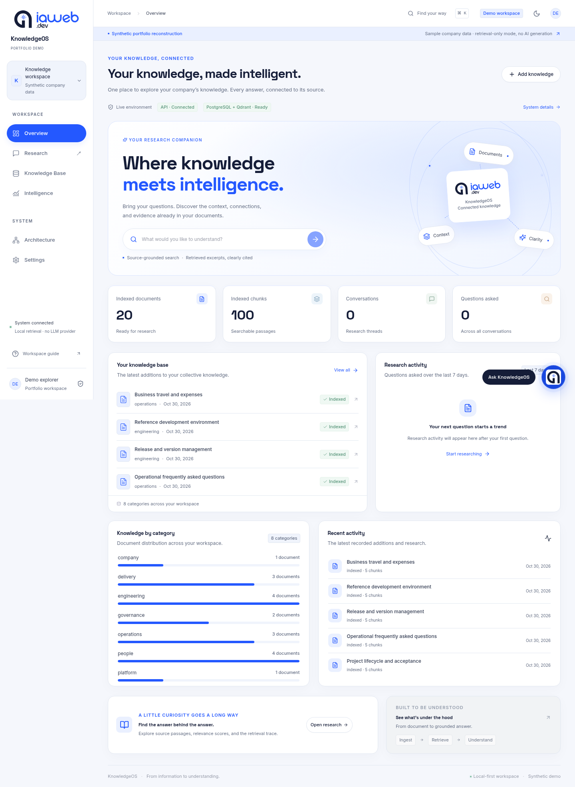
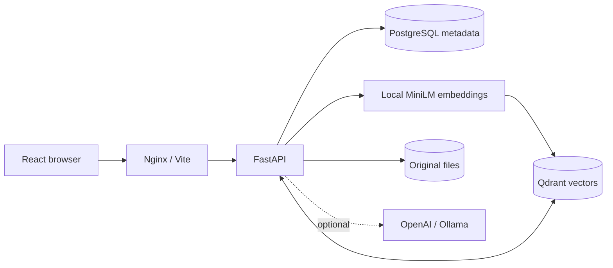
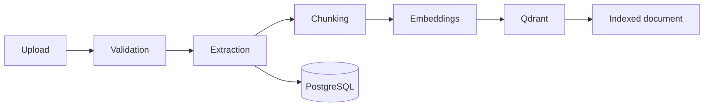
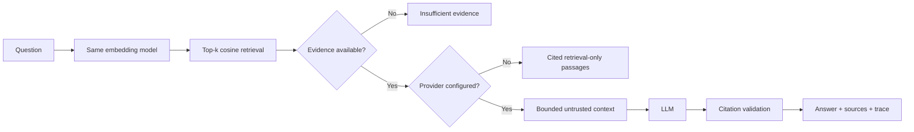

<div align="center">
  
  <h1>KnowledgeOS</h1>
  <p>Portfolio by <a href="https://github.com/CHAKRAbdedaym">CHAKRAbdedaym</a></p>
  <p><strong>Enterprise AI Knowledge Intelligence</strong></p>
  <p>A complete document-to-evidence workspace: local embeddings, real vector retrieval, inspectable citations and optional grounded generation.</p>
</div>

> **Synthetic portfolio reconstruction.** This project is inspired by an enterprise RAG internship experience at IAWEB.DEV. It is an independently reconstructed demonstration, **not an actual deployed client system**. All included company policies, knowledge documents, organizational details and identities are fictional. They are not authentic IAWEB.DEV internal materials.

The interface references IAWEB.DEV’s blue/navy visual language and displays its public logo at the project owner’s request. The logo remains a third-party mark, excluded from this project’s MIT license; see [asset attribution](THIRD_PARTY_NOTICES.md). KnowledgeOS is an independent portfolio demo.



## What you can demonstrate

- A live dashboard backed by stored documents, chunks, conversations and executed queries.
- Real PDF, Markdown and TXT upload → extraction → chunking → local embeddings → Qdrant indexing.
- A persistent research workspace with conversation create/rename/delete, cited passages, source inspection and retrieval traces.
- A bottom-right quick-chat assistant on every page: ask without leaving your workspace, inspect cited passages, and continue the saved conversation in Research.
- Honest **retrieval-only** operation without a paid key; optional OpenAI or Ollama answer generation with a bounded grounding prompt.
- Searchable and filterable document grid/list, extracted text preview, duplicate protection, reindexing and vector cleanup.
- Recorded query volume, latency, retrieved chunk counts and source references. No invented accuracy, cost savings or benchmark claims.
- A visual architecture explorer, sanitized settings, dark/light themes and responsive layouts.
- Twenty coherent fictional policies, repeatable seeding, an evaluation question set and French interview materials.

## Stack and reasons

| Layer | Choice | Why |
|---|---|---|
| UI | React + TypeScript + Vite | Typed reusable components and fast local development |
| UI system | Tailwind, locally owned shadcn/ui + Radix primitives, Lucide, Inter, Space Grotesk, Motion | Accessible interaction foundations and a consistent visual language |
| Data/navigation | TanStack Query, React Router | Explicit asynchronous state and navigable workspaces |
| Charts | Recharts | Charts derived directly from real API data |
| API | Python 3.13, FastAPI, Pydantic | Validated contracts and generated OpenAPI |
| Metadata | PostgreSQL, SQLAlchemy, Alembic | Transactions, relationships and versioned schema evolution |
| Retrieval | LangChain Core + langchain-qdrant + Qdrant | Inspectable vector-store integration and actual cosine search |
| Embeddings | MiniLM through FastEmbed/ONNX Runtime | Local CPU inference without a large GPU runtime |
| Extraction | pypdf | Page-aware PDF extraction with a permissive license |
| Generation | OpenAI or Ollama, configured at runtime | Real model calls when configured; no provider dependency for retrieval |
| Verification | pytest, HTTPX, Vitest, Testing Library, Playwright | Unit, API, interaction and real browser checks |
| Runtime | Docker Compose + Nginx | Repeatable local services and persistent volumes |

Exact dependency resolutions are tracked. See [dependency notes](docs/DEPENDENCIES.md) for official references and license considerations.

## System architecture







Read [ARCHITECTURE.md](docs/ARCHITECTURE.md) for persistence and request flows, and [RAG_DEEP_DIVE.md](docs/RAG_DEEP_DIVE.md) for embeddings, similarity, prompts and failure modes.

## Quick start with Docker Compose

Prerequisites: Git, Docker Engine/Desktop with Compose v2.24+, Python 3.11+ for the standard-library seed scripts, a browser, and internet access for initial dependency/model downloads. A modern CPU and about 4 GB available memory are a practical starting point for this small corpus. No GPU or paid key is required.

```sh
git clone https://github.com/CHAKRAbdedaym/knowledgeos-enterprise-rag.git
cd knowledgeos-enterprise-rag
cp .env.example .env
docker compose up --build -d
docker compose logs -f backend
# In another terminal, after the backend is ready:
python3 scripts/seed.py
```

Open **http://localhost:8080**. Backend startup applies Alembic migrations automatically. The first seeded document downloads the local embedding model; allow extra time. The seed script uses the real multipart ingestion endpoint and reports failures. Running it again skips identical files by content hash.

```sh
curl http://localhost:8000/api/readiness
docker compose ps
# Stop services, retaining all named volumes:
docker compose down
```

The four persistent volumes retain PostgreSQL data, Qdrant data, uploaded originals and model artifacts. Do not add `-v` to `down` unless you intend to erase this local demo's data.

| Service | Local URL / port |
|---|---|
| Application | http://localhost:8080 |
| API | http://localhost:8000/api |
| Interactive OpenAPI | http://localhost:8000/api/docs or `/docs` |
| Schema | http://localhost:8000/api/openapi.json |
| Qdrant dashboard | http://localhost:6333/dashboard |
| PostgreSQL | `localhost:5433`, database/user `knowledgeos` |
| Vite, when running separately | http://localhost:5173 |

Published container ports bind only to `127.0.0.1`. PostgreSQL uses 5433 to avoid common conflicts with an existing host database; override `POSTGRES_PORT` if needed. The default database password is an intentionally public **local demo value**, not a production credential.

## Environment and provider modes

Copy `.env.example`; never commit `.env`. Compose injects its values into the backend and replaces hostnames with container-network names where needed.

| Variable | Meaning |
|---|---|
| `LLM_PROVIDER` | `none` (default), `openai`, or `ollama` |
| `LLM_MODEL` | Supported model identifier available to your provider account/local server |
| `OPENAI_API_KEY` | Server-side key; required only for OpenAI |
| `OLLAMA_URL` | Reachable Ollama API URL when using that provider |
| `DATABASE_URL` | SQLAlchemy PostgreSQL URL; Compose supplies its internal service URL |
| `POSTGRES_PASSWORD`, `POSTGRES_PORT` | Local database connection settings |
| `QDRANT_URL`, `QDRANT_COLLECTION` | Vector server and collection |
| `EMBEDDING_MODEL` | `sentence-transformers/all-MiniLM-L6-v2` |
| `MODEL_CACHE_DIR`, `UPLOAD_DIR` | Persistent runtime directories |
| `CORS_ORIGINS` | JSON array of explicitly allowed frontend origins |

Additional validated limits and retrieval defaults are documented in `backend/app/config.py`. Model identity and dimensions are intentionally guarded: changing the embedding model requires rebuilding/migrating the collection, not just editing an environment variable.

### No paid API

Leave `LLM_PROVIDER=none`. All extraction, embedding, indexing and search run locally. Research shows **retrieval-only** and the exact retrieved passages, scores and sources. It does not claim an AI-written answer. An empty retrieval produces an insufficient-evidence response.

### Real OpenAI generation

Set the following in your local `.env`:

```dotenv
LLM_PROVIDER=openai
LLM_MODEL=gpt-4.1-mini
OPENAI_API_KEY=your-own-key
```

Use a model your account supports with Chat Completions JSON output and `max_completion_tokens`. The example is configurable, not a promise of account access. Recreate the backend:

```sh
docker compose up -d --force-recreate backend
```

Ask a question and inspect the `grounded` message mode and citations. Settings shows configured state, not a live provider billing/availability check. Provider failures produce a visible error. The application sends the selected passages, question and bounded history to the provider; keep them synthetic.

### Optional Ollama

Install and run Ollama separately, obtain a compatible model using its official instructions, set `LLM_PROVIDER=ollama`, `LLM_MODEL=<installed-model>`, and `OLLAMA_URL=<reachable-url>`. Docker Desktop commonly provides `host.docker.internal`; Linux hosts may require an explicit host-gateway mapping and a server listener reachable from the container. This repository does not install models or expose Ollama on your behalf. Live Ollama generation must be verified on your own configured runtime.

## Separate local development

Start the data services:

```sh
docker compose up -d postgres qdrant
```

Backend, in one terminal:

```sh
cd backend
python3 -m venv .venv
. .venv/bin/activate
pip install -r requirements-dev.txt
cp ../.env.example .env
alembic upgrade head
uvicorn app.main:app --host 127.0.0.1 --port 8000
```

Frontend, in another terminal, using Node 22:

```sh
cd frontend
npm ci
npm run dev
```

Vite proxies `/api` to `localhost:8000`. Run the seed script from the repository root. Do not run the local API and container API on port 8000 simultaneously.

## Corpus, questions and evaluation

For a ready-to-use HR frontend walkthrough, see [test.md](test.md): French instructions, English prompts, expected source documents and missing-information checks.

`data/synthetic/` contains twenty explicitly labeled fictional policies covering company operations, onboarding, HR, leave, remote work, IT, security, incidents, engineering, API development, support, governance, AI, training, delivery, releases, setup and travel. The manifest declares categories and tags; no actual employee data is included.

Example questions:

- How many remote-work days are allowed per week?
- What is the remote-work approval process?
- How should a security incident be reported?
- What checks are required before a production release?
- What is the response target for a priority-one support incident?
- How do I bake a sourdough loaf with rye flour? *(Unsupported; inspect abstention.)*

```sh
python3 scripts/seed.py
python3 scripts/evaluate.py
python3 scripts/acceptance.py
```

The evaluation file declares expected source documents. Reported hit rate measures that small question set only; it is not overall RAG accuracy. Diagnostics and acceptance requests are real queries and therefore contribute to analytics. Acceptance creates and cleans up a uniquely named synthetic upload and conversation; its query events remain recorded.

## API usage

```sh
curl -F 'file=@data/synthetic/05_leave_remote.md' \
  -F 'category=People' http://localhost:8000/api/documents

curl -H 'Content-Type: application/json' \
  -d '{"question":"What is the remote-work approval process?","top_k":5,"score_threshold":0.3}' \
  http://localhost:8000/api/retrieval
```

Use an actual filename from `data/synthetic/manifest.json` if changing the example. The [architecture API table](docs/ARCHITECTURE.md#api-contract) and live OpenAPI document describe all typed routes. Upload duplicates return 409, invalid inputs 422, oversized requests 413, unavailable dependencies/providers 503, and rate limits 429.

## Tests and CI

```sh
# After installing backend dev dependencies:
cd backend
.venv/bin/python -m pytest -q
.venv/bin/ruff check app tests migrations
# In frontend/ after npm ci:
npm run lint
npm run typecheck
npm run test
npm run build
# From repository root against a running seeded stack:
python3 scripts/acceptance.py
```

The GitHub Actions workflow runs backend tests, migrations and real Qdrant integration plus frontend lint, typecheck, component tests and build. Deterministic test embeddings and mocked generation are explicitly test fixtures, never the running application path. See [TESTING.md](docs/TESTING.md) for commands actually executed, browser results and unverified cases. [Recorded evaluation](data/evaluation-results.json) retains both source hits and unsupported-query failures.

## Screenshots from the running application

[Research and citations](docs/screenshots/research-citations.png) · [Knowledge Base](docs/screenshots/knowledge-base.png) · [Mobile](docs/screenshots/overview-mobile.png) · [Dark theme](docs/screenshots/overview-dark.png)

These are actual UI captures with persisted synthetic documents and real query records, not design mockups.

## Repository map

```text
backend/                 FastAPI app, typed schemas, services, migrations, tests
frontend/                React application, UI primitives, styles and browser tests
data/synthetic/          Fictional documents, manifest and evaluation questions
scripts/                 Real API seeding, retrieval evaluation and acceptance
docs/                    Architecture, design, security, evidence and French guides
.github/workflows/       CI quality checks
compose.yaml             Four-service local deployment and persistent volumes
.env.example             Public placeholders and retrieval-only defaults
Makefile                 Common development commands
```

## Demonstration and interview preparation

Read [INTERVIEW_GUIDE.md](docs/INTERVIEW_GUIDE.md) for French pitches and 40+ technical questions/answers. Follow [DEMO_SCRIPT_FR.md](docs/DEMO_SCRIPT_FR.md) for a 5–7 minute walkthrough with a no-key route. Before presenting, seed and warm the model, inspect readiness, ask one supported and one unsupported question, and confirm that the UI mode matches the intended demonstration.

Show the passage that supports a claim, its page/offset metadata, the vector score and the recorded query. Explain why a similarity score is not confidence and why citation validation does not prove entailment. Distinguish internship context from this reconstructed implementation clearly.

## Troubleshooting

| Symptom | Check / action |
|---|---|
| Port already used | Check existing services; set `POSTGRES_PORT` or adjust the relevant loopback mapping. Do not stop unrelated services. |
| Containers fail to build | Inspect `docker compose logs` and build output; verify network, disk space and Docker daemon access. |
| First upload is slow | Model download and warmup happen on first embedding. Watch backend logs; retain the model cache. |
| Model download fails | Verify outbound model-host access and disk permissions. After fixing it, use document Reindex. |
| Document shows failed | Check Qdrant readiness and model cache, then reindex. The original extracted document remains available. |
| Readiness returns 503 | Ensure PostgreSQL and Qdrant are running and `alembic upgrade head` succeeded. |
| Provider error | Confirm key, billing/access, model JSON support, network and timeout. Retrieval-only mode requires none of these. |
| No matching evidence | Inspect sources/threshold, use an explicit English question, and check the target document is indexed. |
| Scanned PDF rejected | Run OCR before upload; OCR is not bundled. |
| Duplicate upload | Identical bytes already exist. Reindex the existing record or change the content intentionally. |
| Browser cannot reach API | Check `/api/readiness`, Vite/nginx proxy and configured origins. |
| Rate limit after repeated tests | Wait one minute; the limiter is deliberately per-process and local. |

## Limitations and roadmap

This is a single-user, single-worker demo without authentication or tenant authorization. It is not safe for confidential data or public network exposure. See [SECURITY.md](docs/SECURITY.md) for the data retention boundary and a concrete hardening path.

Current tradeoffs include synchronous indexing, character-based chunks, dense-only English retrieval, no OCR, non-streaming generation, a small evaluation set, no full history-aware query rewrite and no distributed transaction between SQL and Qdrant. Current lists/analytics suit a demonstration corpus. A production evolution would add authorized retrieval, durable ingestion workers, reconciliation, pagination/SQL aggregates, hybrid search/reranking, tokenizer-aware chunking and a representative human-reviewed evaluation set.

No paid-provider quality, large-scale throughput, cost savings or client deployment claim is made. Real verification evidence is kept separate from these future improvements.

## GitHub repository

The public repository is [CHAKRAbdedaym/knowledgeos-enterprise-rag](https://github.com/CHAKRAbdedaym/knowledgeos-enterprise-rag). See [GitHub Actions](https://github.com/CHAKRAbdedaym/knowledgeos-enterprise-rag/actions) for checks on each push and pull request.

The owner’s working copy uses this SSH remote:

```sh
git remote set-url origin git@github.com:CHAKRAbdedaym/knowledgeos-enterprise-rag.git
git push origin main
```

Review `git status`, ignored files and the staged diff before publishing changes. Environment secrets, uploads, databases and model caches are excluded by `.gitignore`. The repository contains synthetic example documents; application conversation history is local database state, not repository content.
