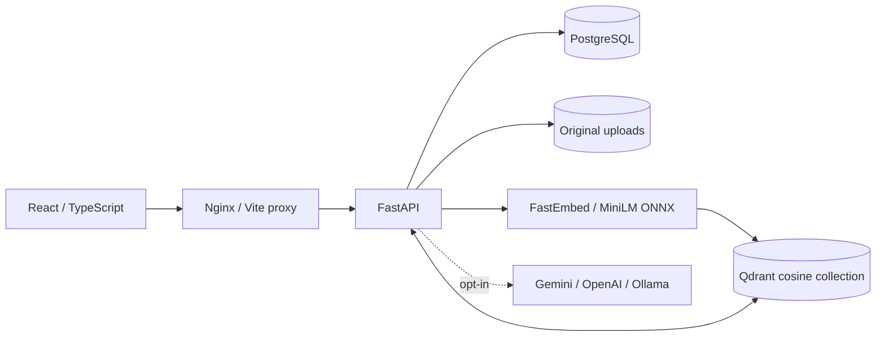
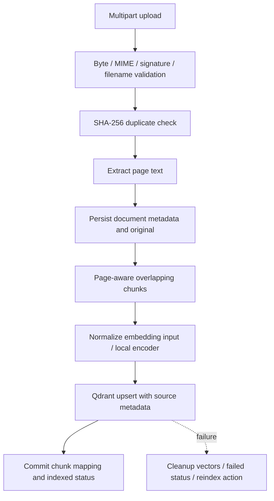
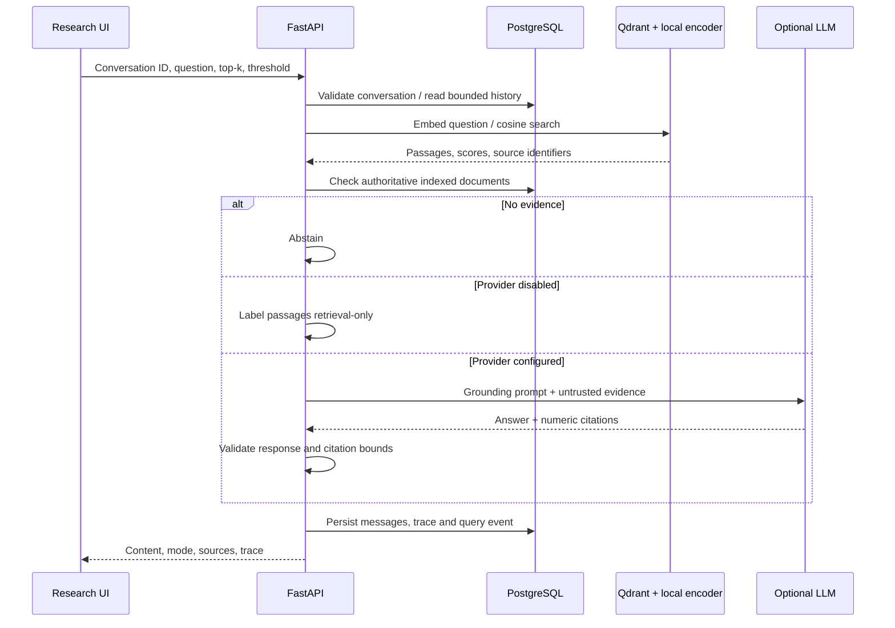
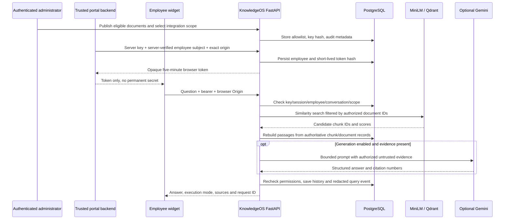

# Architecture

KnowledgeOS is a local single-enterprise portfolio reconstruction. Included IAWEB.DEV content is synthetic. It implements a real dense-retrieval pipeline and optional grounded generation, with no claim of a deployed client system.

## Administrator authentication

The first enterprise slice protects existing routes with server-side administrator sessions and CSRF checks. Login, logout, bootstrap, migration and remaining boundaries are documented in [ADMIN_AUTH.md](ADMIN_AUTH.md). Only minimal liveness is anonymous. The integration API/widget are implemented below; live Gemini model access and grounded generation have now been verified (2026-11-02).

## Ownership boundaries

The frontend routes browser interactions through a typed API client and TanStack Query. React Router owns six application routes. Components render real pending, error and empty states. Nginx proxies `/api` to the backend in Compose; Vite provides the same path in local development. No provider key is compiled into JavaScript.

The backend separates configuration, database sessions, SQLAlchemy models, upload extraction/chunking, indexing, retrieval, generation, schema contracts, security middleware and routes. A small number of explicit service functions is easier to inspect than an autonomous agent framework for this workload. LangChain is used for document and embedding interfaces and the Qdrant adapter; there is no hidden agent tool loop.

PostgreSQL is the authority for document lifecycle, chunk mapping, conversation history and query events. Qdrant stores embeddings and source payloads. The uploads volume retains originals using generated document IDs. The model-cache volume persists downloaded public ONNX artifacts. Alembic owns schema changes; API startup executes versioned migrations in the single-replica Compose setup.

## Ingestion flow

Uploads are bounded and synchronous. Browser byte-upload progress is distinct from extraction and embedding. A successful transfer does not imply indexing has completed. `indexed`, `indexing` and `failed` states are explicit. Duplicate file bytes produce HTTP 409. Reindexing replaces the document's previous vector entries and chunk metadata. It does not append duplicates.

Original text and character offsets remain traceable. PDFs retain page numbers; plain text and Markdown have null page references. A chunk UUID also identifies its Qdrant point. Metadata includes document ID, title, page, offsets and embedding identity. A failed record can be inspected and reindexed after infrastructure recovery.

## Question flow

Generation is a request/response operation. The UI displays honest processing status rather than simulated token streaming. External provider errors return a safe failure; retry is explicit. Conversation history is scoped to the selected conversation and bounded before sending to a provider. Retrieval uses the current question rather than a separate history-rewrite model.

## Persistence model

| Entity | Meaning | Important invariants |
|---|---|---|
| documents | Title, original filename, category, tags, hash, extracted text/pages, status, timestamps | Unique content hash; no server path returned |
| chunks | Source text, page, offsets and document FK | UUID maps to Qdrant point; no embeddings in SQL |
| conversations | Title and creation time | Independent history boundaries |
| messages | Role, content, mode, source snapshots and trace | Historical citations remain inspectable |
| query_logs | Question, timing, mode, chunk count and referenced document IDs | Only executed requests contribute to metrics |

Query-event retention is independent of conversation deletion. Document deletion removes its searchable vectors and current metadata; historical message snapshots remain. This supports source inspection but means document deletion is not full content erasure.

## API contract

The canonical typed schema is available at `/api/openapi.json` and interactive documentation at `/api/docs` (`/docs` redirects).

| Method and path | Behavior |
|---|---|
| GET `/api/health` | Process liveness |
| GET `/api/readiness` | Migrated PostgreSQL and Qdrant connectivity |
| GET `/api/config` | Sanitized provider/embedding/retrieval configuration |
| GET / POST `/api/documents` | List / multipart upload, category and comma-separated or JSON-array tags |
| GET / DELETE `/api/documents/{id}` | Metadata + extracted preview / remove document and vectors |
| POST `/api/documents/{id}/reindex` | Rebuild from stored extracted pages |
| GET / POST `/api/conversations` | List / create |
| GET / PATCH / DELETE `/api/conversations/{id}` | Read history / rename / delete |
| POST `/api/conversations/{id}/messages` | Submit `{question, top_k?, score_threshold?}` |
| POST `/api/retrieval` | Inspect real retrieved sources and timing; records a query event |
| GET `/api/dashboard` | Stored counts, categories, trend, documents and activity |
| GET `/api/analytics?days=7` | Recorded volume, latency and references; accepts 7, 30 or 90 |

A source includes `document_id`, `title`, `chunk_id`, `text`, `score`, `page`, `start_offset`, `end_offset`. A message includes role, content, mode, sources, trace and timestamp. A trace records retrieval and total latency, provider/model, embedding identity, top-k, threshold and match count. Errors contain a safe detail plus a structured error code and optional field validation details.

## Consistency and failure recovery

There is no atomic transaction across SQL and Qdrant. The indexing service marks lifecycle state, writes/deletes vectors, then commits metadata. It attempts compensating cleanup on failure. Queries reject non-indexed documents. A process crash between systems can leave stale vectors or incomplete records; reindex/delete retries repair common cases, but a production design needs a durable job queue, outbox and reconciliation task.

Per-process mutation locking simplifies the single-worker demo. Multiple API replicas would need coordinated ingestion and migration management. Lists and analytics are intentionally simple for a small corpus; SQL aggregation, pagination and retention become necessary at scale.

Readiness means database/schema and vector-service connectivity, not that the embedding model is already warmed or that an external provider has a valid balance. Provider/model status in Settings is configuration information; a real generated request is the proof of generation availability.

## Deployment boundary

Compose starts PostgreSQL, Qdrant, FastAPI and Nginx. Published ports bind only to localhost. Named volumes outlive `docker compose down`. `docker compose down -v` deletes demo data and should be used only when a reset is intended. Backend startup migrations are suitable for one demo replica; deploy migrations as a separate reviewed job for production.

See [SECURITY.md](SECURITY.md) for authorization, privacy, parser isolation and hardening gaps. See [RAG_DEEP_DIVE.md](RAG_DEEP_DIVE.md) for retrieval limitations and evaluation interpretation.

## Enterprise implementation — 2026-11-02

This section supersedes the earlier statement that integration permissions and the widget are future work. The runtime remains one enterprise; multiple integrations are separate clients within that enterprise, not separate tenants.

### Implementation boundaries

- `auth.py` and `admin_cli.py` retain administrator passwords/sessions/CSRF. Legacy application routes remain administrator-only; employee histories are excluded from legacy conversation APIs.
- `enterprise.py` owns separate admin integration management and `/api/v1` employee routes. A server key authenticates a trusted portal; only that server attests an employee subject. The demo selector is explicitly not an identity provider.
- `employee_cors.py` adds exact registered-origin bearer CORS without credentialed browser cookies. Origin checks supplement authentication, never replace it.
- `runtime.py` merges validated, persisted retrieval/provider preferences with environment configuration. No API accepts provider secrets or arbitrary provider URLs.
- `gemini.py` implements the official REST adapter, bounded retries, quota handling and safe failures. Live model access and grounded generation were verified with the owner-configured key; remaining quota/billing tier are not exposed by that check. See `GEMINI_CONFIGURATION.md`.
- `widget/knowledgeos-widget.js` is an independent Shadow DOM web component. `examples/intranet` serves a fictional portal and exchanges short-lived tokens server-side. It uses the same backend answer pipeline, with no canned answers.

### Additive schema and preservation

Migration `0003_enterprise_integrations`, following `0002_admin_auth`, adds integrations, hashed scoped credentials, explicit integration-document joins, employees, widget sessions, security audits and runtime settings. Conversations gain integration/employee ownership; existing rows with both fields null remain admin conversations. Query events gain channel/integration metadata. Existing documents gain `employee_available=false`: historical documents remain private.

The Qdrant payload already contains `metadata.document_id`. Filtered searches therefore require no collection replacement, vector backfill or embedding-model change. SQL source IDs and indexing status are checked again after vector search. The real migration was applied after a PostgreSQL dump and full original-vector snapshot; the original rows and all 100 vector payloads/embeddings were compared unchanged afterward.

### Permission changes and history

Access is the intersection of published, indexed documents and the integration's explicit allowlist. Empty scope denies all. Each source-view request repeats the check. Historical employee messages are withheld when any saved source is no longer permitted; follow-up generation then fails closed too. Scope and credential validity are rechecked after generation before returning content. Revocation cannot retract bytes already received by a browser or provider. Concurrent delivery and revocation do not constitute a distributed transactional confidentiality guarantee.

Detailed route contracts, credential scopes and examples: [Enterprise API](ENTERPRISE_API.md). Widget token and cookie boundaries: [Widget integration](WIDGET_INTEGRATION.md). Actual verification: [Testing](TESTING.md).
